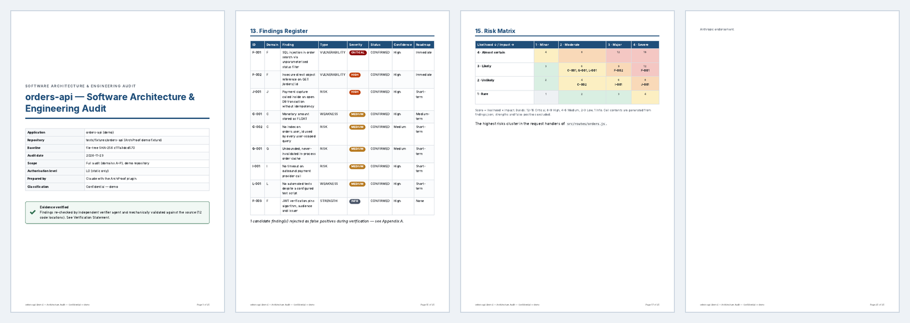

# ArchProof

Evidence-driven software architecture and technical due-diligence audits for Claude, with independent verification of every finding and a downloadable PDF report.



**The plugin itself lives in [`plugin/`](plugin/). Read [`plugin/README.md`](plugin/README.md) for what ArchProof does, its commands, deep mode, data handling and installation.**

## Repository layout

| Path | What it is | Shipped to users? |
|---|---|---|
| `plugin/` | The Claude plugin: skill, references, 13 agents, 6 commands, examples and icon. Markdown, JSON and images only | Yes (this is the folder submitted to the Claude plugin directory) |
| `tools/` | Optional automated validator (`validate_findings.py`, standard library only) and PDF builder (`build_report.py`) | No |
| `tests/` | A demo service with **intentional** defects (`fixtures/orders-api/`, never executed), plus the self-test | No |
| `.claude-plugin/marketplace.json` | A Claude Code marketplace that points at `./plugin` | — |
| `.github/workflows/ci.yml` | Self-test, plugin validation and a file-policy check for `plugin/` | — |

## Install

```
/plugin marketplace add almas-alright/archproof
/plugin install archproof@archproof
```

On claude.ai and in Cowork, install ArchProof from the Claude plugin directory, or upload a zip of the `plugin/` folder.

## Development

Requirements: Python 3.9+, the packages in `tools/requirements.txt` (install them with [pip](https://pip.pypa.io/en/stable/user_guide/)), and a Chromium for Playwright (see the [Playwright Python docs](https://playwright.dev/python/docs/intro)).

```bash
bash tests/run_selftest.sh                          # validator, negative tests, deep mode, demo PDFs
claude plugin validate ./plugin --profile directory  # plugin structure and directory checks
```

Rules for `plugin/`: it may contain only Markdown, text, JSON, YAML and images, with no scripts or package-manager files. CI enforces this. Raise `version` in `plugin/.claude-plugin/plugin.json` with every release, and add a `CHANGELOG.md` entry.

See [CONTRIBUTING.md](CONTRIBUTING.md) and [SECURITY.md](SECURITY.md).

## License

[MIT](LICENSE) © 2026 Almas
