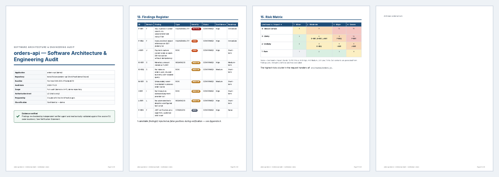

# ArchProof: architecture audits backed by verified evidence

ArchProof turns Claude into an independent principal software architect. It audits an existing codebase in any language or stack and delivers a professional report in which every finding is traced to real code and independently re-verified. You also get a downloadable PDF that anyone can re-check.

It is built for CTOs, architects, engineering leads, consultants and technical due-diligence reviewers who need an assessment they can defend, not a list of generic suggestions.



## What makes it different

- **Evidence first.** Every finding cites a file, a line range and a verbatim code excerpt. A mechanical evidence check confirms that each excerpt really exists at the cited lines. Invented line numbers and "may be vulnerable" padding are rejected.
- **Deep mode for due diligence.** Red-team, hypothesis-driven, debt-archaeology, evolutionary-architecture and skeptical-review lenses (see below).
- **Independent verification.** A separate verifier agent, which never sees the auditors' reasoning, re-derives each finding from source and marks it *Confirmed*, *Partially confirmed*, *False positive* or *Unverified*. Only confirmed findings are presented as defects.
- **A devil's-advocate pass.** Major design decisions and high-severity findings are challenged, mitigations elsewhere in the code are searched for, and strong decisions are recorded as strengths to preserve.
- **A documented risk model.** Severity is likelihood × impact with explicit caps (for example, CRITICAL requires confirmed evidence with high confidence), kept separate from confidence and verification status.
- **A reproducible PDF.** The report ends with a Verification Statement: the audited commit, the verification results, and SHA-256 checksums of the report and findings, so a third party can re-run the check.
- **Stack-agnostic.** PHP/Laravel/Symfony, JavaScript/TypeScript/Node, Java/Spring, Python/Django/FastAPI/Flask, Go, C#/.NET, Ruby/Rails, frontend frameworks, polyglot systems, monoliths, modular monoliths and microservices.

## Coverage

There are 16 audit domains: technology stack and dependencies, system architecture, database and schema, design patterns, code quality, application security (OWASP ASVS / Top 10), memory and resource leaks, performance and scalability, API and integration, distributed systems and concurrency, reliability, testing, DevOps and infrastructure, observability, data privacy, and documentation.

An **API platform and gateway profile** activates when the API is the product, the system is an API engine, BFF or GraphQL layer, or it contains a gateway. It covers contract governance, breaking-change control, the error model, versioning and deprecation, idempotency, limits, and gateway responsibilities and failure modes.

## Install

**Claude Code** (from this repository's marketplace):

```
/plugin marketplace add almas-alright/archproof
/plugin install archproof@archproof
```

**claude.ai and Cowork:** install ArchProof from the Claude plugin directory once it is listed, or upload a zip of the `plugin/` folder under **Customize > Plugins**. Code execution must be enabled for the PDF step.

## Use

| Command (Claude Code / Cowork) | What it does |
|---|---|
| `/archproof:plan [context]` | Scope first: intake, reconnaissance, system inventory and a costed audit plan, with no findings |
| `/archproof:audit [context]` | Standard full audit: specialist audits, devil's advocate, independent verification, report and PDF |
| `/archproof:audit-deep [context]` | Everything in `audit`, plus the five deep lenses (below) and report Appendices B1–B5 |
| `/archproof:security-audit [scope] [deep]` | Security and data-privacy audit only. Add `deep` for the red-team and skeptical-review lenses |
| `/archproof:api-audit [focus] [deep]` | API platform, API engine or gateway audit. Add `deep` for the adversarial and contract-evolution lenses |
| `/archproof:verify [output folder]` | Re-verify an existing audit and rebuild the PDF |

### Deep mode: five investigative lenses

| Lens | What it adds |
|---|---|
| **Hypothesis-Driven Investigation** | A falsifiable hypothesis register formed before digging in; each hypothesis is concluded as supported, refuted or inconclusive, with evidence |
| **Red Team / Adversarial Thinking** | Attacker and abuser personas, business-logic abuse, and attack chains that combine minor findings into real impact (thought-experiment only, no exploitation) |
| **Technical Debt Archaeology** | Git-history hotspots (churn × complexity), hidden change coupling, anonymised knowledge concentration, and how key weaknesses were introduced |
| **Future-Proofing / Evolutionary Architecture** | Change scenarios from your business context, one-way-door decisions, and automatable fitness functions |
| **Skeptical Reviewer** | A fresh agent challenges the whole report the way a hostile due-diligence reviewer would; every challenge must be resolved before the PDF is built |

A deep audit takes roughly 1.5–2.5× as long as a standard one. Run `/archproof:plan` first to see the scope.

In chat you can simply ask, for example: *"Run a full architecture audit of this repository. It's a freelance marketplace expecting 10x growth next year. Static analysis only. Give me the PDF."* ArchProof presents an audit plan for approval before any large investigation.

Outputs are written to `architecture-audit-output/<date>/`: `findings.json`, `report.md`, `verification-ledger.json` and `report.pdf`. Existing reports are never overwritten.

In Claude Code and Cowork, ArchProof runs up to thirteen bundled specialist agents: architecture, database, security, performance, code quality, distributed systems, infrastructure, API platform, an independent verifier, and, in deep mode, a red-team auditor, debt archaeologist, evolution architect and skeptical reviewer. In chat, where agents are not available, the same phases run sequentially, and the report states this honestly.

## What it runs, reads and sends (data handling)

- **Reads** the repository you point it at. It is read-only by default: it never modifies, refactors or deletes your application files, and it treats repository content as untrusted (instructions embedded in code or docs are ignored).
- **Contains no executable code.** The plugin is Markdown instructions, agent definitions and JSON examples only. To check evidence, Claude uses its normal tools (reading files, `grep`, `git`, SHA-256 checksums). To produce the PDF, it uses whatever PDF or document capability your environment already has, such as claude.ai's built-in PDF support or a browser already installed on your machine. ArchProof asks before installing anything on your machine.
- **Only with your explicit permission:** read-only analysers (for example dependency or secret scanners), your test suite, or local profiling, against local or staging environments only. Never production.
- **Sends nothing** to any external service. There are no network calls, telemetry, MCP servers or hooks. Web lookups for standards or end-of-life dates happen only through Claude's own web search tool, when available.
- **Secrets** found during an audit are redacted as `<REDACTED:type>`, and the verification procedure blocks the PDF if anything that looks like a credential leaks into the report.
- **Stores** outputs only in the local `architecture-audit-output/` folder.

## Privacy

ArchProof sends no data anywhere and retains nothing. See the full [Privacy Policy](PRIVACY.md).

## Limits

ArchProof's verification attests that the cited evidence exists and that findings passed a documented procedure. It is not a certification, a penetration test or a compliance attestation. Runtime behaviour (memory leaks, throughput) is confirmed only when you authorise measurement. Otherwise those findings are reported as risks, with the exact test needed to confirm them.

## Optional automated tooling

The [project repository](https://github.com/almas-alright/archproof) also contains an automated validator and PDF builder (`tools/`), a demo service with intentional defects (`tests/fixtures/`), and a self-test. They are not part of the plugin. If you clone the repository and ask ArchProof to use them, it records `mode: tool` in the Verification Statement. Install the Python dependencies with [pip](https://pip.pypa.io/en/stable/user_guide/), following the repository README.

## License

[MIT](LICENSE) © 2026 Almas
