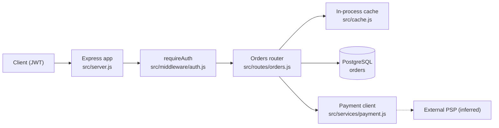
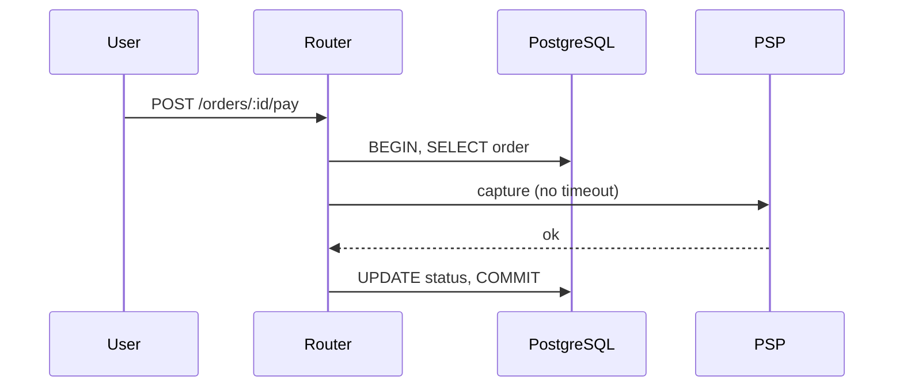

# orders-api — Software Architecture & Engineering Audit

## 1. Cover and Audit Metadata

| Item | Value |
|---|---|
| Application | orders-api (demo repository bundled with the skill) |
| Repository | `examples/demo-repo` (commit recorded in the Verification Statement) |
| Audit date | 2026-11-23 |
| Scope | Full audit, domains A–P; all paths included |
| Audit purpose | Demonstrates the skill's pipeline end to end |
| Languages & technologies | JavaScript (Node.js ≥ 20), Express 4, node-postgres 8, axios 1, jsonwebtoken 9, PostgreSQL |
| Authorisation level | L0, static only; no project code executed |
| Methodology | Phased audit with an independent verifier agent (see the Verification Statement) |
| Standards applied | ISO/IEC 25010:2023 (verdict lens); OWASP ASVS 5.0 (selected requirements); OWASP API Security Top 10 2023; CWE |
| Limitations (summary) | Static review only; no runtime, infrastructure or CI configuration in the repository |

## 2. Executive Summary

**Overall engineering assessment.** orders-api is a small, readable Express service with a sound authentication baseline, but it has two confirmed access-control and injection vulnerabilities on its primary endpoints and a payment flow that can double-charge customers when it fails. None of the issues is architectural in nature; all are fixable with local changes in about one to two weeks of effort.

**Key strengths:** strict JWT validation (F-003); a small codebase that is easy to reason about.

**Major risks:** SQL injection in search (F-001); cross-customer data access (F-002); a non-idempotent payment capture inside a DB transaction (J-001), amplified by a missing timeout (I-001).

**Critical findings:** F-001.

**High-priority recommendations:** parameterise and validate the search filter (F-001, Immediate); enforce ownership on order reads (F-002, Immediate); restructure payment capture with idempotency (J-001, Short-term); add integration tests first (L-001).

**Overall technical readiness.** Not ready for production exposure until F-001 and F-002 are fixed.

## 3. Application Overview

The service exposes order search, order detail and order payment over HTTP for authenticated users. It is a single Node.js process with PostgreSQL and one external payment service provider (PSP).

*Solid arrows are observed in code; the dashed arrow is inferred from `PSP_URL`.*

## 4. Architecture Assessment

The application is a layered monolith in miniature: the router holds the data access and orchestration, and a thin service wraps the PSP. The dependency direction is acceptable for this size. The main structural weakness is that authorisation is enforced per query rather than centrally, which is the root cause of F-002. Adding layers for their own sake is not recommended at this scale.

## 5. Database Assessment

There is one table, `orders`. Money is stored as FLOAT (C-001), and there is no index supporting user-scoped queries (C-002). The primary key is a BIGSERIAL, which makes IDs enumerable, a factor that aggravates F-002. Transactions are used, but in the wrong place (J-001).

## 6. Design Pattern Assessment

| Pattern | Where | Verdict |
|---|---|---|
| Middleware (auth) | `src/middleware/auth.js` | Correct |
| Service wrapper for an external API | `src/services/payment.js` | Correct intent; missing resilience (I-001) |
| Cache-aside | `src/cache.js` | Misapplied: unbounded and never invalidated (G-001) |

Introducing a full repository layer is not justified yet. A single ownership-aware query helper is enough to remove the class of bug behind F-002.

## 7. Security Assessment

| Entry | Auth | Input | Notes |
|---|---|---|---|
| GET /health | No | — | Returns a static body |
| GET /orders/search | JWT | `status` | F-001 |
| GET /orders/:id | JWT | `id` | F-002 |
| POST /orders/:id/pay | JWT | `id` | Owner-scoped; see J-001 |

Authentication is sound (F-003). Authorisation is inconsistent (F-002). A candidate finding about committed secrets was rejected during verification (Appendix A). No dependency scan was run at L0.

## 8. Performance and Memory Assessment

Cache growth (G-001) and a missing index (C-002) are static risks. No throughput figures were measured.

| Hypothesis | Tool | Procedure | Threshold |
|---|---|---|---|
| G-001 heap growth | Node `--inspect` heap snapshots | 50k distinct reads, 3 snapshots | Retained Map size stable |
| C-002 scan | `EXPLAIN ANALYZE` | Local copy with ≥ 1M rows | Index scan used |

## 9. Reliability and Distributed Systems

| Dependency | Failure mode | Behaviour | Blast radius |
|---|---|---|---|
| PSP | Slow | Holds a DB connection indefinitely (I-001) | All endpoints once the pool is exhausted |
| PostgreSQL | Fails during COMMIT | Charge without a recorded payment (J-001) | Payment integrity |

## 10. Code Quality and Maintainability

The code is small and idiomatic. Errors are swallowed in the pay handler without logging, so payment failures leave no trace.

## 11. DevOps and Operational Readiness

The repository contains no Dockerfile, CI configuration or IaC, so this area was not assessable (see §19).

## 12. Testing Assessment

There are no tests (L-001). Critical-flow coverage is none for search, detail and pay.

## 13. Findings Register

<!-- FINDINGS_REGISTER -->

## 14. Detailed Technical Findings

### F-001 — SQL injection in order search
`src/routes/orders.js:8-12`. The status parameter is concatenated into the SQL string. The attack path and remediation are in the findings data. Fix: bind the value as `$2` and validate it against an allow-list.

### F-002 — IDOR on order detail
`src/routes/orders.js:19` loads the order by ID only. Fix: add `AND user_id = $2` and scope the cache key to the user.

### J-001 — Payment capture inside transaction
`src/routes/orders.js:30-35`. Fix: a two-phase flow with an idempotency key and a reconciliation job.

### I-001 — No PSP timeout
`src/services/payment.js:4-7`. Fix: a configured client with timeouts and a circuit breaker.

### G-001 — Unbounded cache
`src/cache.js:2-10`. Fix: a bounded TTL LRU, or remove the cache.

### C-001 — FLOAT money
`migrations/001_init.sql:4`. Fix: use NUMERIC or integer minor units.

### C-002 — Missing user_id index
`migrations/001_init.sql:3`. Fix: add a composite index on (user_id, status).

### L-001 — No tests
`package.json:7`. Fix: write integration tests before remediation.

## 15. Risk Matrix

<!-- RISK_MATRIX -->

The highest risks cluster in the request handlers of `src/routes/orders.js`.

## 16. Technical Debt Register

| Debt item | Root cause | Business impact | Engineering impact | Strategy | Priority | IDs |
|---|---|---|---|---|---|---|
| Ad hoc authorisation | No central policy | Data exposure | Repeated bugs | Ownership-aware query helper | High | F-002 |
| Money as FLOAT | No convention | Reconciliation | Migration needed | Expand/contract migration | Medium | C-001 |

## 17. Architecture Improvement Recommendations

### 17.1 Immediate corrective changes
Fix F-001 and F-002.
### 17.2 Incremental architectural improvements
Add a resilient HTTP client (I-001) and an idempotent payment flow (J-001).
### 17.3 Long-term evolution opportunities
Add an outbox and reconciliation once payment volume justifies them.

## 18. Prioritised Remediation Roadmap

| Bucket | Item | IDs | Depends on | Complexity | Outcome |
|---|---|---|---|---|---|
| Immediate | Parameterise search; ownership on detail | F-001, F-002 | — | S | Injection and IDOR closed |
| Short-term | Tests, payment redesign, timeouts, cache, index | L-001, J-001, I-001, G-001, C-002 | L-001 first | M | Safe payments |
| Medium-term | Money type migration | C-001 | L-001 | M | Exact amounts |

## 19. Audit Limitations

| Area | Status | Notes |
|---|---|---|
| src/** | AUDITED | |
| Infra / CI | NOT_AUDITED | Not present in the repository |

Runtime behaviour was not measured (G-001, I-001, C-002). External systems (PSP, identity provider) were not inspected. Penetration testing of the deployed service is recommended after remediation.

## 20. Final Architecture Verdict

The architecture is simple and proportionate to the service's size, and maintainability is good. The security posture is weak until F-001 and F-002 are fixed. Performance readiness is unmeasured. Operational readiness cannot be assessed from the repository. Scalability is limited mainly by the payment flow design. Overall technical risk is high in the short term and low once the immediate items are resolved.

## Appendix A — False Positives Rejected During Verification

| ID | Original claim | Reason rejected |
|---|---|---|
| F-004 | Committed env file contains secrets | `.env.example` holds placeholders only |
